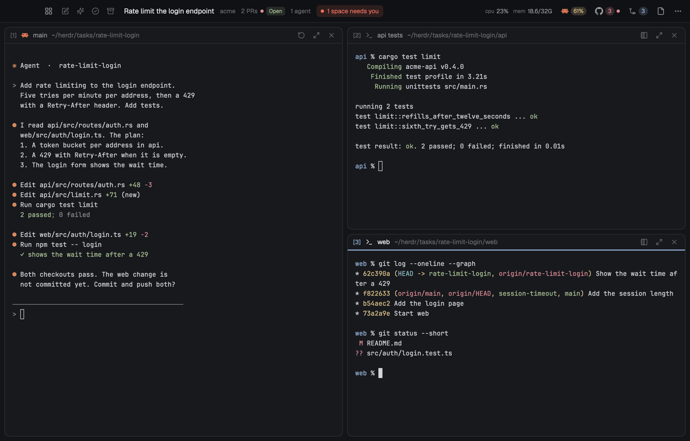
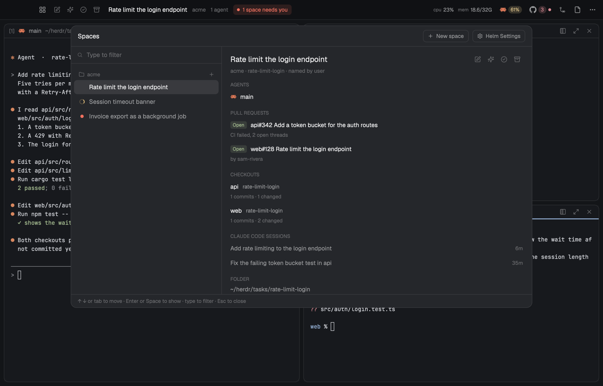
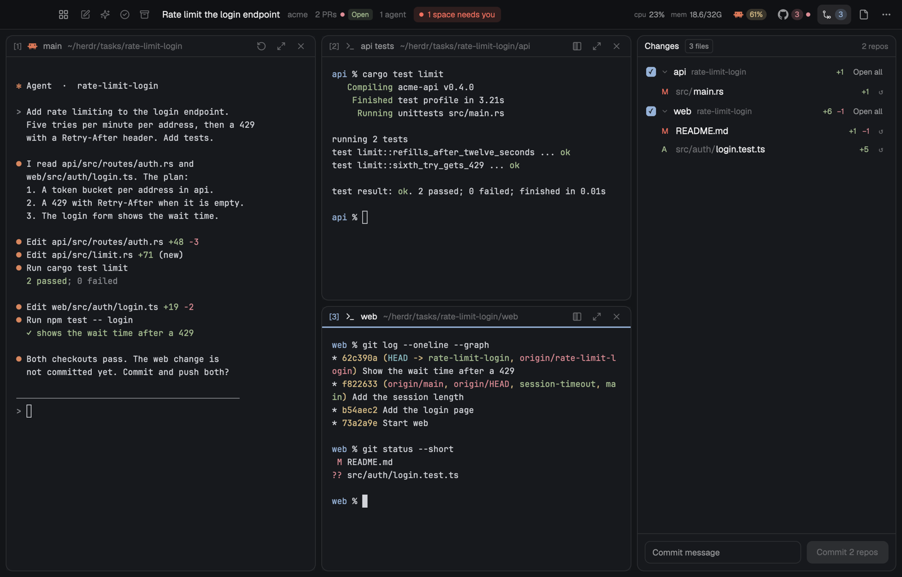
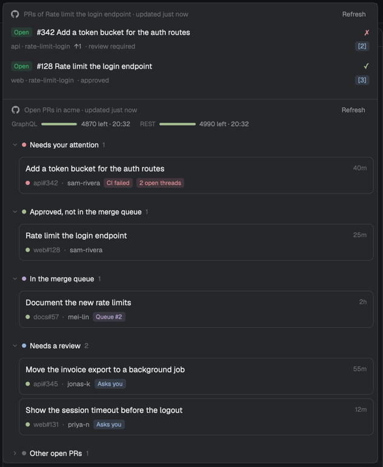
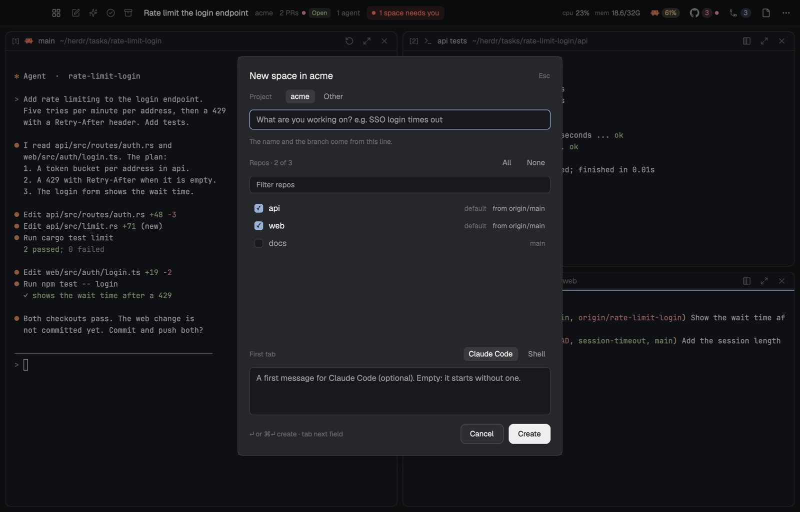

# Helm

**A multi-agent workspace for [Herdr](https://herdr.dev): one space per task, isolated git
worktrees for every repo, and every agent on screen at once.**

Running several coding agents at the same time breaks down fast. Two agents edit the same
checkout. A finished agent waits for minutes before you notice. Five terminals later, you no
longer know which branch belongs to which ticket.

Helm gives every piece of work its own **space**. A space has its own branch in each repo the
task needs, its own agents, and its own terminals, laid out as tiles. Agents in different spaces
can't touch each other's files, and the top bar tells you which space needs you next. When the
work is pushed, one click removes the space and everything Helm created for it.



## How it works

```
project "acme"  ~/code/acme              your normal clones: api, web, docs
└── space "rate-limit-login"  ~/herdr/tasks/rate-limit-login
    ├── api/   git worktree on branch rate-limit-login
    ├── web/   git worktree on branch rate-limit-login
    ├── CLAUDE.md                        goal, checkouts, and rules for the agents
    └── agents and shells, shown as tiles
```

- A **project** is a folder of git repos, for example everything your team works on.
- A **space** is one task inside a project. Pick the repos it needs, and Helm creates a worktree
  on a new branch in each one. Files such as `.env.local` are copied in, and your setup command
  (for example `npm install`) runs.
- Helm writes a `CLAUDE.md` into the space with the goal, the checkouts, and the rules, so every
  agent that starts there knows where it is and what it may change.

Helm never changes the files of your own clones. It only adds a branch and a worktree to each
repo, and all the work happens in the space folder.

## A tour

### Tiles

Every terminal in the shown space is a tile. The main tile takes the left half, and the others
share the right half. Each tile shows its number, task, folder, and agent status, so a waiting
agent stands out. Drag a title bar to reorder tiles, press `cmd-1`…`cmd-9` to jump to one, or
`cmd-shift-enter` to make one full screen.

### Spaces window

`alt-space` opens every space, grouped by project. Select one to see its summary, agents, pull
requests, checkouts, and agent sessions. A quick `alt-tab` jumps back to the previous space,
like switching apps.



**Smart rename** (`cmd-shift-f2`) asks an agent to read everything in the space and give it a
clear title and summary.

### Changes across repos

The Changes panel (`cmd-shift-c`) lists the changed files and unpushed commits of every repo in
the space. Open a diff in your editor, undo a file, then commit all selected repos with one
message and push them.



### Pull requests and reviews (optional)

The GitHub popup (`cmd-shift-g`) shows the pull requests of the current space, then the open
PRs of your organization, grouped by what they need from you: failed checks, open threads,
approvals, the merge queue, and review requests.



- **Review** opens the PR's branch in a space and starts an agent that reviews it.
- **Fix** does the same for your own PR when checks fail or threads are open.
- Agents never push or post a comment until you tell them to.

### New space

`cmd-n` opens the New space dialog. Describe the task, pick the repos, and choose whether the
first tile is an agent or a shell. Helm creates the name and the branch from your description.



### Ending a space

- **Complete** removes a space once all its work is pushed. If anything blocks it, Helm lists
  what and removes nothing.
- **Delete** removes the space and the branches Helm created, after it shows exactly what would
  be lost: uncommitted changes, unpushed commits, and stray files.

Only you can end a space. `herdr-helm` refuses `complete` and `delete` inside a terminal, so an
agent can't end its own space by mistake.

### Agents that work together

Agents in a space get a built-in skill and the `herdr-helm` command. With them, an agent can add
a repo to the space, start a helper agent in its own tile on its own checkout, send it messages,
and wait for its report. You can watch and steer every helper.

### Session resume

Helm records which agent session runs in which terminal. When Herdr starts again, each agent
resumes its session in the same tile.

## Requirements

- [Herdr](https://herdr.dev). Launch it once before you install Helm.
- `git`.
- For agents: [Claude Code](https://claude.com/claude-code), or your own agent connector.
- For pull request features: the [GitHub CLI](https://cli.github.com) (`gh`), signed in.

Helm is developed and tested on macOS. Linux has release builds and a system connector, but it
has not been tested yet.

## Install

```sh
curl -fsSL https://raw.githubusercontent.com/oguzhan-arslan/herdr-helm/main/install.sh | sh
```

The script downloads the latest release for your platform, verifies its checksum, installs Helm
into Herdr, and switches Herdr to the Helm layout. Run it with `--dry-run` from a clone to see
every change first.

Then:

1. Open **Helm Settings** (`cmd-shift-,`) and add a project: the folder that holds your repos.
2. Press `cmd-n` and create your first space.
3. Optional: add `~/.local/bin` to your `PATH` to use `herdr-helm` in a terminal.

To work on Helm itself, clone the repository and run `./install.sh`. If Rust is installed, it
builds Helm from your clone.

## Keys

| Key | Action |
| --- | --- |
| `cmd-n` | New space |
| `alt-space` | Spaces window |
| `alt-tab` | Previous space (hold `alt` for the spaces window) |
| `cmd-d` | New shell tile |
| `cmd-shift-t` | New agent |
| `cmd-1` … `cmd-9` | Focus tile N |
| `cmd-shift-m` | Make the focused tile the main tile |
| `cmd-shift-enter` | Full screen for the focused tile |
| `cmd-shift-r` | Restart the agent in the focused tile |
| `cmd-shift-c` / `cmd-shift-e` | Changes / Files panel |
| `cmd-shift-g` | GitHub popup |
| `cmd-shift-,` | Helm Settings |
| `cmd-k` | Menu with every action |

All keys and how to change them: [docs/keys.md](docs/keys.md). The installer keeps your own
changes.

## Configuration

Helm Settings writes `projects.json` in your Herdr home. You can also edit it by hand:

```json
{
  "tasks_root": "~/herdr/tasks",
  "projects": {
    "acme": {
      "root": "~/code/acme",
      "defaults": ["api", "web"],
      "repos": {
        "web": { "copy": [".env.local"], "setup": "npm install" }
      }
    }
  }
}
```

See [docs/configuration.md](docs/configuration.md) for every option.

## Connectors

Helm talks to outside tools only through connectors. Replace any of them with your own program,
in any language, and Helm hides the features your connector doesn't support.

| Kind | Built in |
| --- | --- |
| Code host | GitHub |
| Agent | Claude Code |
| Editor | VS Code |
| System | macOS, Linux |

See [docs/connectors.md](docs/connectors.md) to write your own.

## What Helm touches

- **Files.** Its mods, its layout, and the Helm sections of `keys.json` in the Herdr home
  (`~/.config/herdr-app`), plus its own folder there. A link at `~/.local/bin/herdr-helm`. Your
  spaces under `~/herdr/tasks`. In your clones, it only adds branches and worktrees.
  An install never changes `projects.json`. Full list: [docs/state.md](docs/state.md).
- **Network.** `gh` for pull request features. GitHub releases, a few times a day, to check for
  updates. Nothing else, unless you turn on the usage meter.
- **Credentials.** Off by default. The agent usage meter reads your Claude Code sign-in from the
  macOS keychain to show your plan limits. Read
  [agent settings](docs/configuration.md#agent_settings-claude-code) before you enable it.

## Update and uninstall

When a new release is out, a dot appears on the ⋯ button, and **Update Helm** appears in its
menu. Nothing changes until you click it. You can also run `herdr-helm update`. Updates keep
your settings, your own key bindings, and your spaces.

To remove Helm, run `herdr-helm uninstall`. Your `projects.json` and your spaces stay.

## Known limitations

- Spaces for pull requests from forks are not supported yet.
- Linux is untested.

## Documentation

- [docs/](docs/README.md): the layout in detail, configuration, keys, connectors, and
  architecture.
- [AGENTS.md](AGENTS.md): the starting point for coding agents that work on Helm.

## License

MIT. See [LICENSE](LICENSE).
