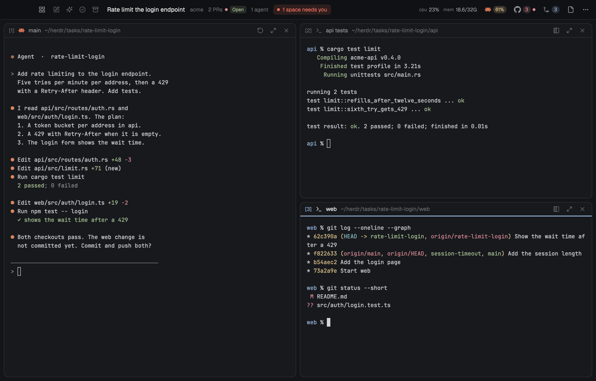

# Helm

Helm is a layout for a person who runs many coding agents at the same time, on many tasks. Each
task is a space with its own git worktree and branch in each repo that it needs. The terminals of
the shown space fill the window as tiles. A thin top bar shows the space, which other space needs
you, and the PRs that wait for your review.



## Add it

Helm is more than its files. The mods call the program `herdr-helm`, and they share code from
`mods/_shared/`, which only the installer copies into each mod. So do not copy the `layouts/` and
`mods/` folders by hand. Run the installer instead:

```sh
curl -fsSL https://raw.githubusercontent.com/oguzhan-arslan/herdr-helm/main/install.sh | sh
```

The installer downloads the release program for this machine, checks its SHA-256 sum, writes the
layout, the mods, and the Helm keys into the Herdr home, and switches to the layout. A clone with
Rust installed can run `./install.sh` instead, which builds the program from the clone.
`herdr-helm uninstall` removes it again. The person's own layout stays, and `ctrl-shift-l`
switches back.

Tell the person before the install: the mods run `git` and `herdr-helm`. `herdr-helm` reaches the
network through `gh` for the PR features, and asks the GitHub releases of this repo for updates a
few times a day. It reads the macOS keychain only when the person turns on the agent usage meter.

## What you see

Top to bottom:

1. **Top bar**, 42px, a window drag area, canvas background. From left to right:
   - the grid button, which opens the spaces window,
   - the action buttons of the shown space: Rename, Smart rename, Complete, Delete,
   - the space title in 16px semibold, its project in a dim color, its PR state, and its count
     of agents,
   - a red pill "N spaces need you" when an agent in another space is blocked,
   - CPU and memory, the agent usage meter with the agent's own icon and its highest percent,
     the GitHub icon with a badge of the PRs that need you, the Changes and Files buttons, and
     the ⋯ menu. The ⋯ button has a dot when a Helm update is out.
2. **Work body**, a row with a gap of 8px:
   - **The grid** of tiles. Each terminal of the shown space is a tile. The main tile takes the
     left half. The other tiles share the right half, in more rows than columns.
   - **The panel**, 368px wide, hidden until opened: a stack of the Files panel and the Changes
     panel.

Each tile has a title bar: `[N]`, the program icon, the tab name, the folder with `~` for the
home folder, the status, and the buttons Restart (agent tiles), Make main, Full screen, and
Close. The focused tile has an accent line under its title. Terminals have a padding of 14px by
12px.

## How it behaves

- **Agent status**, from Herdr's agent reports:
  - `working`: a spinning spinner in the theme's `working` color, in the tile title and next to
    the space in the spaces window.
  - `blocked`: a "Needs you" pill in the theme's `blocked` color with a 15% tint background. The
    top bar counts the space.
  - `done`: a 7px dot in the theme's `done` color.
  - `idle`: no mark.
- **Tiles.** `cmd-1` to `cmd-9` focus a tile. Drag a title bar onto another tile to swap the two.
  `cmd-shift-m` makes the focused tile the main tile, `cmd-shift-enter` makes it full screen,
  `cmd-w` closes it. Helm keeps the order of each space. A restart of a working agent needs a
  second click within 3 seconds.
- **Spaces window** (`alt-space`, or the grid button): the spaces in groups per project on the
  left, with a filter. The right side shows the selected space: its agents, PRs, checkouts,
  agent sessions, and folder, with its action buttons. `enter` shows the space. A quick
  `alt-tab`, released within 300 ms, goes back to the last space without the window.
- **New space** (`cmd-n`): a dialog with a project, a line of text that gives the name and the
  branch, the repos to check out, and an agent or a shell as the first tab.
- **Changes** (`cmd-shift-c`): the changed files of every repo of the space, with a check box per
  repo, one commit message, and commit and push for all checked repos. An undo of one file takes
  two clicks.
- **Files** (`cmd-shift-e`): the file tree of the focused checkout.
- **GitHub popup** (`cmd-shift-g`): the PRs of the space, then the open PRs of the org in
  sections: needs your attention, approved, in the merge queue, needs a review, other, drafts.
  Review and Fix start an agent in a new space.
- **⋯ menu** (`cmd-k`): every action with its key.
- **Complete** removes a space when all its work is pushed. **Delete** removes it after a list of
  what is lost. Both refuse to run inside a terminal.

## Built from

- **Layout** `layouts/helm.json`: a `column` root with `"titlebar": "none"` and traffic lights
  at 12, 16. Children: `bar` (block, 42px, mod `helm-bar`), `work-body` (row) with `grid` (row,
  gap 8, filled by helm-bar at run time) and `panel` (stack, 368px, hidden) of `files`
  (`helm-files`) and `changes` (`helm-changes`), and `jobs-run` (block, 0px, mod `helm-jobs`).
- **Mods**, each with `"place": "none"` in its `mod.json`:
  - `helm-bar`: the top bar, the tiler of `grid`, and the key commands of the layout.
  - `helm-tile`: the title bar of a tile.
  - `helm-spaces`: the spaces window and alt-tab.
  - `helm-menu`: the ⋯ menu.
  - `helm-github` and `helm-prs`: the two parts of the GitHub popup.
  - `helm-usage`: the agent usage popup and the apps popup of CPU and memory.
  - `helm-files`, `helm-changes`: the two panels.
  - `helm-task`: the New space, Complete, and Delete dialogs.
  - `helm-projects`: Helm Settings.
  - `helm-jobs`: the background work. It writes the shared values that the other mods read.
  - `mods/_shared/`: `helm.js`, `ui.js`, `space-actions.js`. The installer copies them into
    each mod.
- **Shipped mods** that it uses: the icons of `workspace-chrome`.
- **herdr functions**: `exec`, `shared` and `setShared`, `openOverlay`, `spaces`, `agents`,
  `layout`, `run`, `keys`, `theme`, and `appHome`.
- **Programs**: `herdr-helm` (the core, in Rust, with connectors for the code host, the agent,
  the editor, and the system), `git`, and through the connectors `gh`, `claude`, and `code`.
- **Keys**: the sections `layout:helm` and `mod:helm-spaces` of `keys.json`.

## Watch out

- A copy of the folders does not work. The mods need `herdr-helm` and the shared files.
- `helm-jobs` runs in a 0px block that is not hidden. A hidden block does not run its timers.
- A write to a shared value makes every mod render again. The mods write only changed values,
  and never in `render`.
- The PR features need `gh`, signed in, and a code host org in Helm Settings. Without a code
  host, the GitHub parts do not show.
- Helm is tested on macOS. The Linux builds exist, but nobody tested them yet.

## Done when

- `herdr-app status` shows the layout `helm` and no errors.
- `herdr-helm connectors` lists a connector for each kind.
- `cmd-n` makes a space, and its first tile shows the agent with its status.
- `alt-space` shows the space with its checkouts.
- A changed file shows in the Changes panel, and a commit from there lands in each checked repo.
